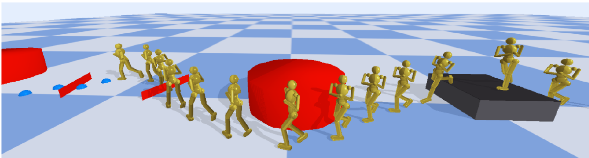

# Diffusion-based Planning with Learned Viability Filters

Code for the paper

> **Diffusion-based Planning with Learned Viability Filters**<br>
> Nicholas Ioannidis, Daniele Reda\*, Setareh Cohan\*, Michiel van de Panne<br>
> *Proceedings of the ACM on Computer Graphics and Interactive Techniques (PACMCGIT), 8(4), Article 62, 2025*<br>
> [doi:10.1145/3747864](https://doi.org/10.1145/3747864)



A diffusion model proposes N short footstep plans (four footsteps each) for a
physics-based humanoid. One or more **viability filters (VFs)**, Q-functions that
predict whether executing a plan keeps the character "alive", score the plans,
and the best one is executed by a pre-trained low-level controller
([ALLSTEPS](https://github.com/belinghy/SteppingStone)). The character replans after
every footstep. VFs are trained offline from collected data and/or online with
the diffusion planner in the loop. They can observe things the planner cannot
(e.g. hurdles) and can be composed at run time.

The repository covers the full pipeline of the paper:

| Stage | Script | Paper |
|---|---|---|
| Data collection with the procedural footstep generator | `scripts/collect_data.py` | Fig. 6, Supp. B.1–B.2 |
| Diffusion planner training | `scripts/train_diffusion.py` | Sec. 6.1, Tab. 4–5 |
| Offline VF training | `scripts/train_vf_offline.py` | Eq. 4, Supp. B.3 |
| Online VF training | `scripts/train_vf_online.py` | Eq. 6, Alg. 1, Tab. 6–7 |
| Evaluation (platform / hurdle / obstacle, number of plans, timing) | `scripts/evaluate.py` | Fig. 7–8, Tab. 1–3, 8 |
| VF composition | `scripts/evaluate_composition.py` | Sec. 7.4 |
| Interactive demo / video | `scripts/demo.py` | |

Baselines from the paper (RL footstep planner, return-conditioned diffusion,
classifier guidance) are not included.

## Installation

Requires Python ≥ 3.9. A GPU is recommended for training.

```bash
git clone https://github.com/nickioan/planning-with-vf.git
cd planning-with-vf
pip install -e .            # or: uv pip install -e .
pip install -e ".[video]"   # optional: moviepy, for recording videos with demo.py
pip install -e ".[wandb]"   # optional: Weights & Biases logging (--wandb)
```

Dependencies: PyTorch, torchvision, NumPy, SciPy, pybullet, einops, tqdm.
The stock `pybullet` package from PyPI is all that is needed.

Quick check (no training needed): run the low-level controller along the procedural
footstep trajectory on 30 cm platforms:

```bash
python scripts/evaluate.py --task platform --planner procedural --values 0.3 --trials 1 --episodes_per_trial 5
```

## Repository structure

```
vfplan/
  envs/          humanoid environment (pybullet): flat / platform / hurdle / obstacle / composed / sequential tasks
  controller/    pre-trained ALLSTEPS low-level controller (allsteps_walker3d.pt)
  diffusion/     conditional DDPM over footstep plans with a 1D temporal U-Net (adapted from Diffuser)
  vf/            viability filters (PlatformVF, HurdleVF, ObstacleVF) and the replay buffer
  encoders.py    heightfield (ResNet-18) and MLP encoders
  planner.py     DiffusionPlanner: sample N plans; score_plans / combine_scores for VFs
  rollout.py     receding-horizon execution of plans, plan selection (random, VF, epsilon-greedy)
  tasks.py       per-task waypoint/obstacle bookkeeping and VF inputs
  evaluation.py  the paper's evaluation protocols
  geometry.py    frames and conventions shared by all of the above
scripts/         command-line entry points (see the table above)
```

Every script has `--help`. Outputs go to the directory given by `--out`: checkpoints,
`args.json` and a `train_log.csv` (add `--wandb` to also log to Weights & Biases).
Use `--device cpu|cuda` to pick a device (default: CUDA if available) and `--seed` for
reproducible terrain sampling.

## Reproducing the paper

No trained diffusion planner or VF checkpoints are distributed, so the steps below
retrain everything from scratch. Paths such as `runs/...` are only suggestions.

### 1. Collect data (Supp. B.2)

The controller follows procedurally generated footstep trajectories. Every
4-footstep window is stored with its conditioning, a success label and its discounted
return. Collection runs on a single CPU core (about 2 hours per 100k plans on a laptop
CPU), so run the commands below as separate processes in parallel.

```bash
# diffusion planner + platform VF data: 100k plans on flat ground, 4 x 100k with platforms
python scripts/collect_data.py --task flat --out data/flat
python scripts/collect_data.py --task platform --min_height 0.10 --out data/platform_10cm
python scripts/collect_data.py --task platform --min_height 0.30 --out data/platform_30cm
python scripts/collect_data.py --task platform --min_height 0.40 --out data/platform_40cm
python scripts/collect_data.py --task platform --min_height 0.50 --out data/platform_50cm

# offline hurdle VF data: 100k plans per hurdle height
python scripts/collect_data.py --task hurdle --hurdle_heights 0.25 --out data/hurdle_25cm
python scripts/collect_data.py --task hurdle --hurdle_heights 0.30 --out data/hurdle_30cm
python scripts/collect_data.py --task hurdle --hurdle_heights 0.35 --out data/hurdle_35cm
```

Platform heights are drawn from 12 evenly spaced values between `--min_height` and
`--max_height` (default 0.65 m). The data format is documented in `vfplan/data.py`.

### 2. Train the diffusion planner (Sec. 6.1, Tab. 5)

```bash
python scripts/train_diffusion.py --data data/flat data/platform_* --out runs/diffusion
```

Only successfully executed plans are used. Defaults follow Tab. 5: 750k steps,
batch size 256, learning rate 2e-5, 20 diffusion steps, ε-prediction, cosine schedule.
A checkpoint (model, EMA model and data normalizers) is written every 50k steps to
`runs/diffusion/checkpoints/diffusion_<step>.pt`. Below, `DP=runs/diffusion/checkpoints/diffusion_750000.pt`.

### 3. Train viability filters

Offline (platform and hurdle tasks), from the collected data:

```bash
python scripts/train_vf_offline.py --task platform --data data/platform_* --diffusion_ckpt $DP --out runs/vf_offline_platform
python scripts/train_vf_offline.py --task hurdle --data data/hurdle_* --diffusion_ckpt $DP --out runs/vf_offline_hurdle
```

Online, with the diffusion planner in the loop (Alg. 1). The platform VF is
bootstrapped from the offline VF (its state encoders are frozen); the hurdle and obstacle
VFs start from scratch:

```bash
python scripts/train_vf_online.py --task platform --diffusion_ckpt $DP \
    --init_from runs/vf_offline_platform/checkpoints/vf_40.pt --out runs/vf_online_platform
python scripts/train_vf_online.py --task hurdle --diffusion_ckpt $DP --out runs/vf_online_hurdle
python scripts/train_vf_online.py --task obstacle --diffusion_ckpt $DP --out runs/vf_online_obstacle
```

Defaults follow Tab. 7: 100k episodes, 200 plans per replanning step, batch size 256
drawn equally from a 100k success buffer and a 50k failure buffer, γ = 0.75,
learning rate 1e-4, soft target updates with τ = 0.01, and ε-greedy exploration
decaying from 0.3 to 0.05. Checkpoints (`checkpoints/vf_<episode>.pt`) hold the target network.

### 4. Evaluate

Each setting is evaluated over 5 trials of 20 episodes. `evaluate.py` appends one row
per trial to a CSV file, and `summarize.py` prints mean ± std tables.

```bash
# Fig. 7 / Tab. 8: platform heights 0.10 ... 0.65 m (100 plans per step)
python scripts/evaluate.py --task platform --planner procedural --out results/platform.csv
python scripts/evaluate.py --task platform --planner dp    --diffusion_ckpt $DP --out results/platform.csv
python scripts/evaluate.py --task platform --planner dp_vf --diffusion_ckpt $DP --vf_ckpt runs/vf_offline_platform/checkpoints/vf_100.pt --out results/platform_offline.csv
python scripts/evaluate.py --task platform --planner dp_vf --diffusion_ckpt $DP --vf_ckpt runs/vf_online_platform/checkpoints/vf_100000.pt --out results/platform_online.csv

# Tab. 1: hurdle heights 25 / 30 / 35 cm (200 plans per step)
python scripts/evaluate.py --task hurdle --planner dp    --diffusion_ckpt $DP --out results/hurdle.csv
python scripts/evaluate.py --task hurdle --planner dp_vf --diffusion_ckpt $DP --vf_ckpt runs/vf_online_hurdle/checkpoints/vf_100000.pt --out results/hurdle.csv

# Tab. 2: avoidance-zone radii 0.5 / 1.0 / 1.5 m (200 plans per step)
python scripts/evaluate.py --task obstacle --planner dp    --diffusion_ckpt $DP --out results/obstacle.csv
python scripts/evaluate.py --task obstacle --planner dp_vf --diffusion_ckpt $DP --vf_ckpt runs/vf_online_obstacle/checkpoints/vf_100000.pt --out results/obstacle.csv

# Fig. 8: number of sampled plans, hardest setting of each task
python scripts/evaluate.py --task platform --planner dp_vf --values 0.65 --n_plans 2 4 8 20 50 100 200 --diffusion_ckpt $DP --vf_ckpt ... --out results/n_plans.csv
python scripts/evaluate.py --task hurdle   --planner dp_vf --values 0.35 --n_plans 2 4 8 20 50 100 200 --diffusion_ckpt $DP --vf_ckpt ... --out results/n_plans.csv
python scripts/evaluate.py --task obstacle --planner dp_vf --values 1.5  --n_plans 2 4 8 20 50 100 200 --diffusion_ckpt $DP --vf_ckpt ... --out results/n_plans.csv

# Tab. 3: time of one sample-and-evaluate step
python scripts/evaluate.py --task obstacle --planner dp_vf --values 1.5 --n_plans 100 200 400 --time_inference --diffusion_ckpt $DP --vf_ckpt ... --out results/timing.csv

# Sec. 7.4: platforms with hurdles on top, platform VF + hurdle VF
python scripts/evaluate_composition.py --diffusion_ckpt $DP --platform_vf ... --hurdle_vf ... --out results/composition.csv

python scripts/summarize.py results/*.csv
```

Evaluation protocols (see `vfplan/evaluation.py`):

* **Platform:** every platform in the episode has the given height. Success means not
  falling within 350 control steps (60 Hz).
* **Hurdle:** every hurdle has the given height. Success means not falling within 350 steps.
* **Obstacle:** every avoidance zone has the given radius. Success means reaching the
  waypoint behind the first zone without entering it or falling.
* **Composition:** platforms (0.4 m) with a 0.2 m hurdle on top. Success means not
  falling within 350 steps.

### 5. Watch it

```bash
python scripts/demo.py --task platform --diffusion_ckpt $DP --vf platform=runs/vf_online_platform/checkpoints/vf_100000.pt
python scripts/demo.py --task sequential --diffusion_ckpt $DP \
    --vf platform=... --vf hurdle=... --vf obstacle=...      # all three VFs, combined by product (Eq. 9)
python scripts/demo.py --task hurdle --diffusion_ckpt $DP --vf hurdle=... --episodes 1 --record hurdle.mp4
```

In the pybullet window, press `r` to end the current episode.

## Notes on the implementation

The code reproduces the setup used for the paper's experiments. Where it differs from
the paper's text, the code reflects what was actually run:

* **Episode horizon:** data collection, online VF training and the obstacle evaluation
  use 1500-step episodes (Tab. 7 lists 1000). An episode that reaches the time limit
  counts as a success.
* **VF losses:** both VF trainers minimize the Huber (smooth L1) loss instead of the
  squared error of Eq. 4–6. The offline VF uses batch size 256 (Tab. 7 lists 512).
* **Composition:** `evaluate_composition.py` combines the VF values by default as a sum
  weighted by each VF's standard deviation over the sampled plans, as in the original
  composition experiment. Eq. 9's product is available with `--combine product` and is
  what `demo.py` uses.
* **Data collection:** episodes are kept only if they are not a full success (surviving
  all 1500 steps with an episode reward above `--min_reward`). Plans that extend beyond
  the last footstep actually reached get a success label below 1, and the last plan of
  an episode gets a return of 0.
* **VF initialization:** in the original experiments the online hurdle VF was
  warm-started from an earlier online hurdle run rather than trained from scratch;
  use `--init_from` to do the same.
* **Planner conditioning:** the diffusion planner sees the heightfield, the character
  state and the waypoint. Hurdles are invisible to its heightfield; only the hurdle VF
  observes them.
* **Physics:** pybullet simulations of this humanoid are not bit-reproducible across
  runs, even with fixed seeds. Expect small run-to-run variations in success rates.

## Citation

```bibtex
@article{ioannidis2025diffusion,
  title   = {Diffusion-based Planning with Learned Viability Filters},
  author  = {Ioannidis, Nicholas and Reda, Daniele and Cohan, Setareh and van de Panne, Michiel},
  journal = {Proceedings of the ACM on Computer Graphics and Interactive Techniques},
  volume  = {8},
  number  = {4},
  articleno = {62},
  year    = {2025},
  doi     = {10.1145/3747864}
}
```

## License and acknowledgements

This code is released under the MIT License (see `LICENSE`). It builds on:
the UBC MOCCA lab's [mocca_envs](https://github.com/UBCMOCCA/mocca_envs) (environment),
[ALLSTEPS](https://github.com/belinghy/SteppingStone) (Xie et al. 2020, low-level controller),
[Diffuser](https://github.com/jannerm/diffuser) (Janner et al. 2022, diffusion model), and
[robomimic](https://github.com/ARISE-Initiative/robomimic) (MLP). See `THIRD_PARTY_NOTICES.md`.
